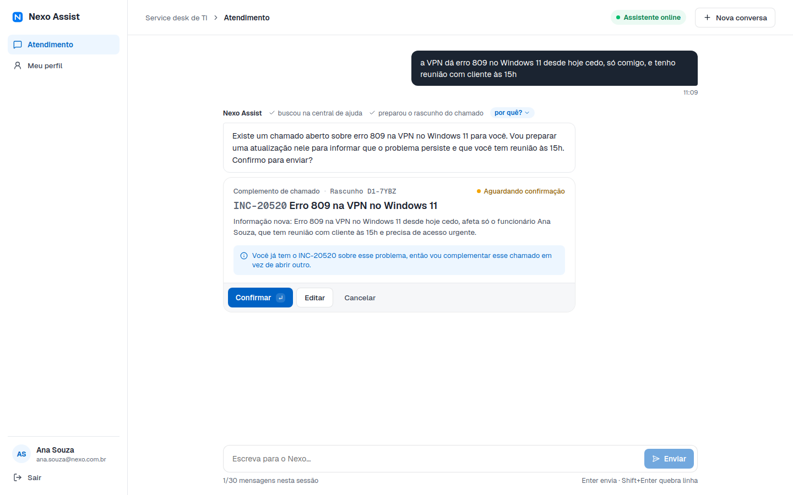
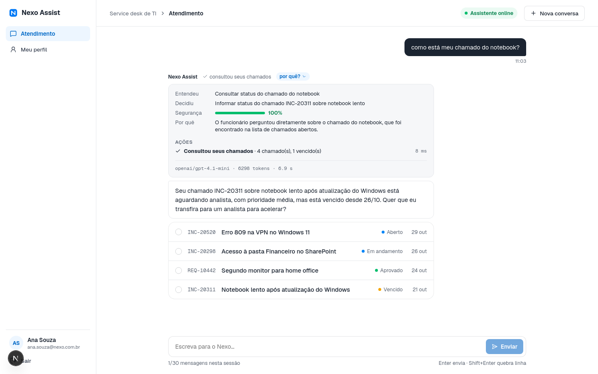
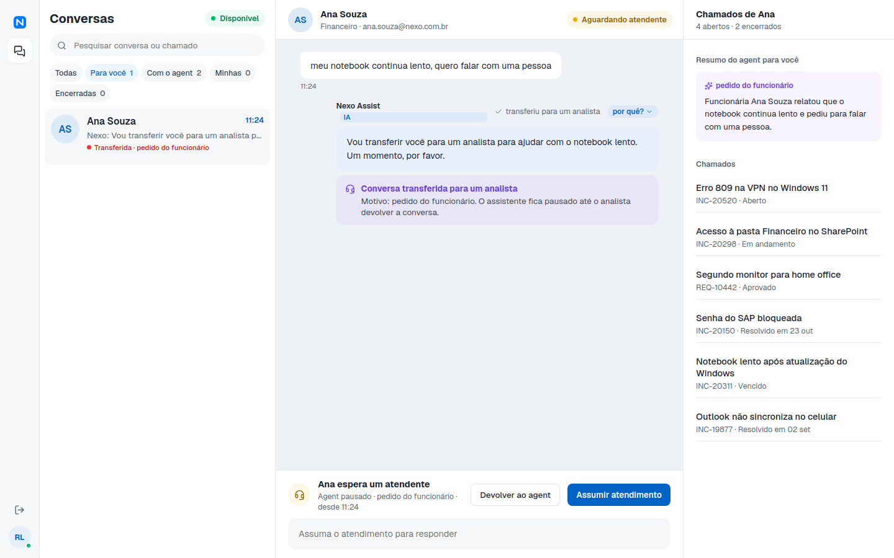
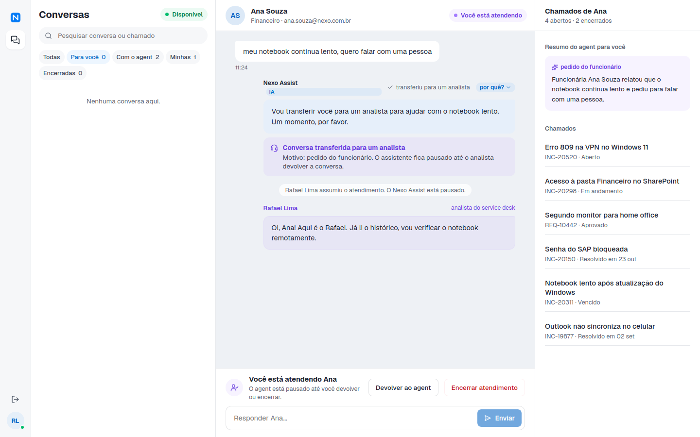

# Nexo Assist

Agent de atendimento do service desk de TI da Nexo. O funcionário descreve o problema num chat; o agent consulta os chamados dele, busca na central de ajuda, abre ou atualiza chamados (sempre mostrando um rascunho antes) e transfere para um analista quando precisa. O analista atende pelo console, com o agent pausado.

Cada resposta mostra o que o agent fez e, ao clicar em **por quê?**, o que ele entendeu, o que decidiu, com que segurança, quais ações executou e quais regras do service desk foram aplicadas.

| Chat: rascunho com verificação de duplicidade | Detalhe da decisão |
| --- | --- |
|  |  |

| Console: conversa transferida | Console: analista atendendo |
| --- | --- |
|  |  |

## Como rodar

Requisitos: Node 22+ e Docker.

```bash
cp .env.example .env        # coloque sua OPENAI_API_KEY
npm install
npm run setup               # sobe o Postgres, aplica as migrations e carrega os dados de exemplo
npm run dev                 # sobe os três serviços
```

Abra http://localhost:3100 e entre com qualquer senha:

| Quem | E-mail | Vai para |
| --- | --- | --- |
| Funcionária | `ana.souza@nexo.com.br` | Chat |
| Funcionária | `carla.mendes@nexo.com.br` | Chat |
| Analista N2 | `rafael.lima@nexo.com.br` | Console |
| Analista N1 | `juliana.costa@nexo.com.br` | Console |

| Serviço | Porta | O que é |
| --- | --- | --- |
| `apps/web` | 3100 | Interface (Next.js): login, chat e console |
| `apps/assist` | 4000 | Agent (Mastra), API do chat, persistência das conversas |
| `apps/tickets-service` | 4001 | Sistema de chamados "legado" simulado |
| Postgres | 5434 | Bancos `tickets` e `assist` |

Outros comandos:

```bash
npm test             # testes automatizados (precisam do Postgres do setup)
npm run typecheck    # TypeScript estrito nos três apps
npm run eval         # avaliação do agent com o modelo real (~US$ 0,02 por rodada)
npm run chat -w @nexo/assist -- ana.souza@nexo.com.br   # conversa pelo terminal, mostrando o trace
```

`npm run setup` recria os dados de exemplo. Os funcionários ganham IDs novos, então quem estava logado precisa sair e entrar de novo.

## Arquitetura

```
 navegador
    │  HTTPS + SSE (texto da resposta em tempo real)
    ▼
┌──────────────┐   Bearer (sessão assinada)   ┌───────────────────────────────┐   x-service-token   ┌──────────────────────┐
│  apps/web    │ ───────────────────────────▶ │  apps/assist                  │ ──────────────────▶ │ apps/tickets-service │
│  Next.js     │                              │  Fastify + Mastra             │   retry c/ backoff  │ Fastify + Drizzle    │
│  login, chat │ ◀─────────────────────────── │  runTurn ─▶ agent ─▶ tools    │ ◀────────────────── │ chamados, artigos,   │
│  console     │                              │  conversas, mensagens, trace  │                     │ funcionários, SLA    │
└──────────────┘                              └──────────────┬────────────────┘                     └──────────┬───────────┘
                                                             │ banco assist                                    │ banco tickets
                                                             ▼                                                 ▼
                                                         ┌────────────────────────── Postgres ──────────────────────────┐
```

- **tickets-service** é o "legado": separado do agent como o PRD pede, com banco próprio, regras do Anexo A (privacidade, duplicidade, reabertura em 7 dias, escalonamento) e o cálculo de prazo em horas úteis. Ele simula a instabilidade descrita no PRD: 10% das chamadas respondem 503 (`TICKETS_FAULT_RATE`). Só aceita chamadas com o token de serviço, que nunca chega ao navegador.
- **assist** é dono das conversas. Guarda conversas, mensagens, o estado de cada conversa (rascunho pendente, com o agent ou com um analista) e o trace de cada resposta no Postgres, então tudo sobrevive a um reinício e o funcionário pode voltar outro dia.
- **web** só fala com o assist. É uma interface fina: quem decide o que mostrar (cards, rascunho, opções) é o agent, por meio de blocos que as tools produzem.

```
apps/assist/src
├── agent/
│   ├── nexo-agent.ts     runTurn: regras antes e depois do modelo, stream, montagem do trace
│   ├── tools.ts          as 9 tools do agent e as regras do Anexo A garantidas em código
│   ├── instructions.ts   prompt com as regras do service desk e o contexto da conversa
│   ├── state.ts          estado da conversa, blocos de interface e formato do trace
│   └── turn-context.ts   o que uma mensagem carrega até as tools (funcionário, estado, trace)
├── tickets/client.ts     cliente do legado com retry e timeout
├── app.ts                API HTTP: login, chat com SSE, console do analista
├── conversations.ts      persistência (Drizzle)
└── evals/run.ts          avaliação com o modelo real
```

## Como o agent decide

Cada mensagem passa por `runTurn` (`apps/assist/src/agent/nexo-agent.ts`):

1. **Antes do modelo, em código.** Se a conversa está com um analista, o modelo nem é chamado. Se a sessão passou de 30 mensagens, responde com o limite.
2. **O modelo decide a ação.** O agent Mastra recebe as regras do Anexo A, quem é o funcionário, a data e hora e o rascunho pendente (se houver), e escolhe entre 9 tools:

   | Tool | Para quê |
   | --- | --- |
   | `registrar_decisao` | Declara o que entendeu, o que vai fazer, a segurança (0 a 1) e o motivo |
   | `buscar_central_ajuda` | Busca artigos antes de abrir chamado |
   | `consultar_chamados` / `detalhar_chamado` | Status, prazo e histórico dos chamados do funcionário |
   | `preparar_chamado` | Monta o rascunho de um chamado novo, verificando duplicidade |
   | `preparar_complemento` | Monta o rascunho de complemento ou reabertura |
   | `confirmar_rascunho` | Cria, complementa ou reabre, depois da confirmação |
   | `oferecer_opcoes` | Botões de resposta rápida |
   | `transferir_para_analista` | Transfere com um resumo do caso |

3. **Depois do modelo, em código.** Se a segurança declarada for menor que 0,5, a conversa é transferida para um analista.

O prompt explica as regras e o porquê, mas **as regras que dá para garantir não dependem do modelo obedecer**:

| Regra do Anexo A | Como é garantida |
| --- | --- |
| Privacidade: chamado só para quem abriu | O funcionário vem da sessão assinada (`requestContext`), nunca de um argumento do modelo. O legado filtra por dono e responde 404 para chamado de outra pessoa |
| Rascunho e confirmação antes de criar **ou atualizar** | `confirmar_rascunho` recusa um rascunho criado na mesma mensagem: o funcionário precisa ter visto e respondido |
| Sem duplicidade | `preparar_chamado` procura chamados parecidos sozinho e transforma o rascunho em complemento ou reabertura |
| Reabertura só até 7 dias | Verificada no legado e em `preparar_complemento` |
| Transferência em caso crítico | Chamado crítico criado transfere a conversa automaticamente |
| Transferência quando o agent não tem segurança | Limite de segurança em `runTurn` |
| Agent não responde com analista | O modelo não é chamado enquanto a conversa está com um analista |
| Limite de 30 mensagens por sessão | Checado no servidor antes do modelo |

O que depende de julgamento (entender o pedido, escolher categoria e prioridade, decidir se um artigo resolve, ficar no escopo de TI) fica com o modelo, e é isso que a avaliação mede.

## Transparência

Cada resposta do agent é salva com um **trace** (`DecisionTrace` em `apps/assist/src/agent/state.ts`), montado de duas fontes:

- **o que de fato aconteceu**, registrado pelas tools: cada ação com resumo, tempo e quantas vezes o legado precisou ser chamado de novo, mais as regras aplicadas (ex.: "Sem duplicidade: já existe INC-20298 sobre o mesmo problema, o rascunho virou atualização");
- **o que o modelo declarou** em `registrar_decisao`: o que entendeu, o que decidiu, a segurança e o motivo. Se o modelo não declarar, o trace diz isso em vez de esconder.

No chat, as ações aparecem acima da resposta ("consultou seus chamados · preparou o rascunho") e o botão **por quê?** abre o detalhe. No console, o analista vê o mesmo trace em cada resposta, mais o resumo que o agent escreveu na transferência.

## Como garanti a qualidade das decisões

**Testes automatizados** (`npm test`, 44 testes):

- `tickets-service` (20): prazo em horas úteis (fim de semana, fora do expediente, crítico 24h), busca por texto, e integração da API com o Postgres: privacidade, duplicidade, reabertura e escalonamento.
- `assist` (24): retry do cliente do legado (503, rede, limite de tentativas, erro de regra não repete), as regras garantidas nas tools (sessão, confirmação, duplicidade, reabertura, crítico) e a API (login, privacidade entre funcionários, SSE, histórico, agent pausado com analista, falha do modelo sem perder a mensagem, fluxo completo do console). Esses testes usam um agent falso, então não gastam com o modelo.

**Avaliação com o modelo real** (`npm run eval`, `apps/assist/src/evals/run.ts`): 8 conversas contra o legado de verdade, verificando as ações e o resultado, não o texto exato:

| Cenário | O que precisa acontecer |
| --- | --- |
| Dúvida coberta pela central | Usa a central, não abre chamado |
| Consulta sem número | Acha o INC-20311 e avisa que está vencido |
| Abertura com dados completos | Rascunho (sem criar) com prioridade média, porque há alternativa |
| Problema que já tem chamado | Rascunho de complemento do INC-20298, não um chamado novo |
| Chamado resolvido há 4 dias | Rascunho de reabertura do INC-20150 |
| Assunto de RH | Redireciona, não abre chamado |
| Pedido de falar com alguém | Transfere |
| Chamado de outra pessoa | Não revela título nem dono |

A primeira rodada deu **5/8**: o agent perguntava coisas desnecessárias ("desde quando?", "quer que eu reabra?") em vez de preparar o rascunho, e classificou como alta um caso com alternativa. Ajustei o prompt (o rascunho já é o pedido de confirmação; só o que o Anexo A exige é obrigatório; regra explícita para média) e a avaliação chegou a **8/8**. Um cenário foi corrigido no próprio teste: o agent oferecia o artigo de autoatendimento do SAP antes de reabrir, o que está certo pelas regras, então o cenário passou a dizer que a pessoa já tentou o artigo.

Como o modelo não é determinístico, uma rodada não prova muito; com mais tempo eu rodaria cada cenário várias vezes e acompanharia a taxa de acerto.

Também testei os fluxos completos num navegador (login, consulta, rascunho, confirmação, transferência, console assumindo e devolvendo).

## Modelo e custo

**OpenAI `gpt-4.1-mini`**, escolhido por ser bom em chamar ferramentas com argumentos estruturados, responder rápido e custar pouco (US$ 0,40 por milhão de tokens de entrada e US$ 1,60 de saída). Pode ser trocado em `ASSIST_MODEL` (formato `provedor/modelo` do Mastra).

Uma mensagem usa de 5 a 10 mil tokens de entrada e algumas centenas de saída, **cerca de US$ 0,003 a 0,005**. O que mantém esse custo:

- só as últimas 12 mensagens vão para o modelo; rascunho e transferência ficam no estado, não no histórico;
- as tools devolvem só os campos que o modelo precisa;
- no máximo 6 etapas por mensagem, timeout de 45 s e limite de 30 mensagens por sessão;
- o prompt fixo vem antes do contexto variável, o que permite o cache automático de prompt da OpenAI;
- mensagens para o analista não chamam o modelo.

## Resiliência e segurança

- O cliente do legado repete chamadas que falham por indisponibilidade (503 ou rede) com espera crescente (250 ms, 500 ms, 1 s), e o trace mostra as repetições. Erros de regra (404, 409) não são repetidos e viram uma resposta clara para o funcionário.
- Se o modelo falhar ou estourar o tempo, o funcionário recebe um aviso e a mensagem dele continua salva.
- A chave da OpenAI e o token do legado ficam só no servidor (`.env`, fora do git).
- O login aceita qualquer senha, como o PRD pede, e emite uma sessão assinada com HMAC (12 h). O console só aceita o papel `analista`.

## Trade-offs

- **Persistência própria em vez da Memory do Mastra**: precisava guardar estado de negócio (rascunho, transferência, quem está atendendo) e o trace, e controlar exatamente o histórico enviado ao modelo.
- **Busca por palavras em vez de embeddings** na central de ajuda e na duplicidade: com poucos artigos é determinística, testável e sem custo; não entende sinônimos distantes.
- **Polling** (3 s) para mensagens do analista e para o console, em vez de WebSocket: mais simples e suficiente para o volume do desafio.
- **Segurança declarada pelo modelo** como gatilho de transferência: é um sinal útil, não uma probabilidade calibrada.
- **Tipos duplicados** entre o assist e o legado: o assist depende só do contrato HTTP, como dependeria de um sistema legado de verdade.

## O que faria com mais tempo

- Rodar a avaliação várias vezes por cenário, em CI, com mais casos (multi-turno, legado fora do ar, prompt injection).
- Embeddings para a central de ajuda e para a duplicidade.
- Mostrar as ações do agent em tempo real durante a resposta (hoje aparecem quando ela termina).
- WebSocket para o console e contadores de não lidas.
- Login de verdade (SSO corporativo) e rate limit por usuário.
- Observabilidade: tracing do Mastra/OpenTelemetry e métricas de custo e taxa de resolução sem fila.

## Deploy

**https://nexo-assist-gustavomf1.onrender.com** (mesmos logins da tabela acima, qualquer senha)

Publicado no Render pelo Blueprint [`render.yaml`](render.yaml), no plano grátis:

- **`nexo-assist-gustavomf1`**: a interface Next.js.
- **`nexo-assist-gustavomf1-api`**: o assist e o sistema de chamados, como dois processos no mesmo serviço (`npm run start:api`). O legado escuta só em `127.0.0.1:4001` e não fica exposto na internet; no plano grátis o Render não tem rede privada entre serviços, então juntar os dois processos foi o jeito de manter o legado fechado.
- **`nexo-db`**: um Postgres compartilhado pelos dois apps (o plano grátis permite um só). As tabelas não se misturam e cada app tem sua própria tabela de migrations. Na primeira subida, o legado carrega os dados de exemplo se o banco estiver vazio.

Proteção de chaves e de custo:

- A chave da OpenAI foi informada direto no painel do Render (`sync: false`) e nunca passou pelo repositório; o token do legado e o segredo da sessão são gerados pelo próprio Render.
- Rate limit por IP: 120 requisições e 8 mensagens por minuto.
- Teto de 300 respostas do agent por dia (`ASSIST_DAILY_AGENT_LIMIT`, cerca de US$ 1,50 no pior caso). Passado o teto, o chat avisa e o modelo não é chamado.

No plano grátis os serviços dormem depois de 15 minutos sem uso: **o primeiro acesso pode levar cerca de 1 minuto**.
